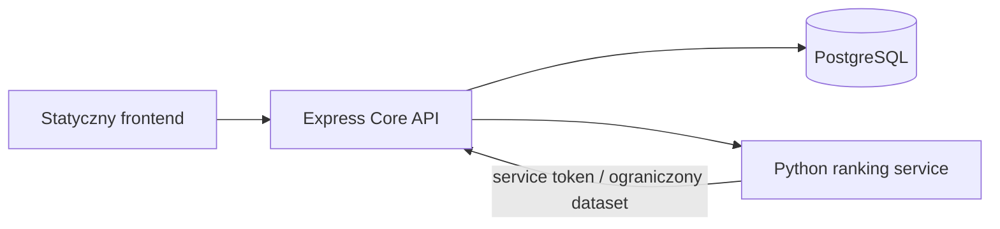

# FSE-IT — audyt i wdrożone poprawki, 2026-10-22

## Aktualny zweryfikowany stan po odblokowaniu środowiska — 2026-10-22

Ta sekcja zastępuje historyczne blokady DB/DNS opisane niżej. Parent uruchomił
przygotowany harness poza wcześniejszym sandboxem, a wyniki niezależnie odczytano
z zachowanych logów. Nie odczytywano produkcyjnej konfiguracji: jawne lokalne
`fse_career_test` i `fse_restore_test`, świeży PostgreSQL17 w `/private/tmp`, loopback
port55443, `DOTENV_CONFIG_PATH=/dev/null`. Po testach serwer zatrzymano i usunięto
wyłącznie własny katalog danych. Żadnych danych produkcyjnych, pushu ani wdrożenia.

| Rzeczywiste uruchomienie | Wynik aktualny |
| --- | --- |
| PostgreSQL17 initdb/start, utworzenie dwóch test DB | PASS, wszystkie exit0 |
| `npm run test:integration` | **10 PASS, 0 FAIL, 0 SKIP**, rzeczywiste HTTP i PostgreSQL |
| Migracja003→004 z celowym błędem | PASS: brak kolumny/ledger po rollback, readiness503; usunięcie wyłącznie testowej kolizji, retry004, readiness200; powtórny migrator bez zmian |
| CRUD/course rollback, współbieżność i uprawnienia | PASS: brak częściowego materiału/tagu po błędzie etapu; dwa edytory200/409; rating upsert/dedup views; izolacja resources/ratings; ukrycie draft; revoked admin/deleted account |
| `npm run test:restore` | **PASS**: uszkodzony dump odrzucony atomowo bez schematu, retry pełnego dumpa, dokładne porównanie14tabel, bcrypt i middleware auth z bieżącą rolą |
| `npm test` | **23 PASS, 0 FAIL, 0 SKIP** |
| `npm run check`, `npm run build` | PASS:35JS, Python compilation/JSON/local assets i frontend build |
| `npm audit --json` | PASS, **0 znanych podatności** w aktualnej odpowiedzi advisory,100 zależności; nie jest to dowód braku wszystkich podatności |
| pg_ctl stop i cleanup | PASS, exit0; własny cluster data usunięty |

Dowody bez credentiali: [`../../career-engineering-audit/evidence/fse-after-update/`](../../career-engineering-audit/evidence/fse-after-update/),
pliki `results.json`, `integration.log`, `restore.log`, `unit.log`, `check.log`,
`build.log`, `audit.log`, `initdb.log`, `pg-start.log`, `pg-stop.log`.
Restore runner zajął6372ms łącznie z przygotowaniem danych; **nie jest to pomiar RTO
produkcyjnej bazy**. Sprawdzono bcrypt i middleware JWT/current-role, nie pełny HTTP
login odtworzonego środowiska.

**P1 readiness004, lokalne integration i rehearsal syntetycznych danych są domknięte.**
Nadal nie oznaczamy całego projektu jako production-ready: brak pełnego browser E2E
Core+ML+UI, konfiguracji i smoke testów docelowego hostingu, odtwarzania provider roles/
uprawnień, retencji i szyfrowania backupów oraz review istniejącego lockfile i clean
`npm ci`. Ledger readiness nie wykrywa ręcznego schema drift przy zachowanym wpisie004.
N+1 legacy courses i limiter per-process pozostają opisanymi ograniczeniami.

Poniższe sekcje zachowują historię baseline, wdrożeń i wcześniejszych blokad; nie są
aktualną listą niezaliczonych bramek DB/DNS.

## Zakres i bezpieczeństwo pracy

Przeanalizowano lokalny FSE-IT: README, manifest, Core API, middleware, katalog, uwierzytelnianie, rekomendacje, testy, migrator i pliki wdrożeniowe. Nie znaleziono lokalnego AGENTS.md ani CODEX_USER_CONTEXT.md. Obowiązują instrukcje katalogu Projekty i `_tools/README.md`. Użyto skilla `javascript-testing-patterns`; zachowano istniejący `node:test` bez dodatkowych zależności.

Repozytorium zaczynało na `main` z licznymi zmodyfikowanymi i nieśledzonymi plikami, w tym middleware, testami, katalogiem i migracją 004. Nie cofnięto zmian, nie wykonano commita, pushu, migracji ani wdrożenia. Nie przypisujemy istniejących zmian do niniejszego audytu. Osobnej gałęzi nie utworzono, aby nie przenosić cudzej niezatwierdzonej pracy pod nowy kontekst. Zmiany tej sesji ograniczono do opisanej niżej poprawki i nowych dokumentów/testów.

## Baseline

| Uruchomienie | Rzeczywisty wynik przed poprawką |
| --- | --- |
| `../_tools/devhouse test FSE-IT` | PASS: 8 testów Node, 6 Python, składnia/zasoby, build |
| Bezpośrednio `node --test tests/unit.test.js tests/demo-materials.test.js` | PASS: 9 testów Node; runner devhouse pomija istniejącą suite demo |
| Nowa suite bezpieczeństwa przed zmianą | 2 PASS, 2 FAIL: alias logowania zwracał 204 zamiast 429; niepoprawny JSON 400 zamiast 429 po wyczerpaniu limitu |

Początkowy PATH nie zawierał `node` i `npm`; baseline wykonano istniejącym Node 24.21.0 z `/Users/macminisk/.local/share/vibeskills-python/python/lib/python3.12/site-packages/playwright/driver/node`, również wybieranym przez devhouse. Discovery całego workspace następnie wskazało istniejący runtime NVM; z `PATH=/Users/macminisk/.nvm/versions/node/v24.22.0/bin:$PATH` wykonano również rzeczywiste skrypty npm opisane poniżej. Nie instalowano runtime ani pakietów.

Pierwsza próba testów HTTP przez socket zakończyła się `listen EPERM: operation not permitted 127.0.0.1`. Następnie testy przerobiono na prawdziwy Express `app.handle` z Node `IncomingMessage`/`ServerResponse`; to ograniczenie środowiska nie zostało zamaskowane jako udany test sieciowy.

## Ustalenia i priorytety

| Priorytet | Potwierdzony problem i dowód | Status |
| --- | --- | --- |
| P1 | Porównanie `req.path` z literalnymi `/login`, `/register` pomijało równoważne `/LOGIN/`; domyślne trasy Express nadal je obsługiwały. Dowód regresji: `tests/security.test.js:32`, poprzedni wynik 204 zamiast 429. | Naprawiono: `server/security.js:32` |
| P2 | Parser JSON znajdował się przed limiterem; 21. błędny JSON zwracał 400, bez zaliczenia żądania do limitu. Dowód: `tests/security.test.js:50`. To obejście ochrony parsera, nie poprawne logowanie ani dowód przejęcia konta. | Naprawiono: parser po limiterze, `server/security.js:46` |
| P1 | Readiness/start wymagają tylko migracji 003 (`server/catalog.js:39`, `coreFSE.js:375`), a aktualne niezatwierdzone endpointy creator/comments wymagają kolumn/tabel migracji 004. Możliwe fałszywe readiness na schemacie 003. | Do poprawki i testu migracyjnego na izolowanej DB; nie uruchamiano SQL |
| P2 | Legacy `/courses` wykonuje 1 zapytanie listy i po jednym na każdy kurs (`coreFSE.js:300`, `coreFSE.js:310`). Jest to potwierdzony wzorzec N+1; brak pomiaru czasu uzasadniającego liczbę ms lub deklarację przyspieszenia. | Pozostawiono do testu i pomiaru przed refaktoryzacją |
| P2 | CI używa `npm install` zamiast `npm ci` (`.github/workflows/ci.yml`, krok instalacji). Lockfile istnieje lokalnie jako wcześniejszy nieśledzony plik; README opisuje jego brak. | Wymaga przeglądu istniejącego lockfile i audytu zależności; nie adoptowano niezweryfikowanego pliku |
| P2 | Brak lokalnego przejścia testów DB, socket HTTP/E2E i restore rehearsal. | Jawna blokada, nie zaliczony gate |
| P3 | Limiter skanuje mapę do 20 000 wpisów przy każdym żądaniu (`server/security.js:31`), jest per-process. | Ryzyko skalowania do zmierzenia, nie udowodniona awaria ani pretekst do Redis |

Nie potwierdzono krytycznej podatności SQL injection, IDOR ani przejęcia konta. Audyt statyczny nie dowodzi ich nieobecności. Nie uruchamiano penetracji systemów zdalnych.

## Wdrożenie

1. `server/security.js:34`: klasyfikacja aliasów auth zgodna z domyślnym routingiem Express; zachowano 20/minutę i wspólny budżet login/register.
2. `server/security.js:47`: parser JSON po limiterze, więc odrzucone nadmiarowe żądania nie wymagają parsowania.
3. `tests/security.test.js`: cztery nowe testy (dwa regresyjne, izolacja limitu API, CORS/nagłówki).
4. `package.json:10`: dopisano suite do istniejącego `npm test` bez zmiany pozostałych skryptów i zależności.
5. ADR: `docs/adr/004-auth-rate-limit-routing.md`.

Nie zmieniono schematu ani logiki biznesowej. Nie wdrożono nowych kolejek, cache, kontenerów lub usług. Opisany fix nie wymaga zmiany architektury całego systemu.

## Weryfikacja końcowa

| Uruchomienie | Wynik |
| --- | --- |
| Node `--test tests/unit.test.js tests/demo-materials.test.js tests/security.test.js` | 13 PASS, 0 FAIL, 0 SKIP |
| `../_tools/devhouse test FSE-IT` | 8 Node PASS, 6 Python PASS, składnia 32 źródeł JavaScript/kompilacja Python/JSON/zasoby PASS, build PASS |
| Node `--test --experimental-test-coverage` dla trzech suite | 13 PASS; security.js: linie 100%, gałęzie 71,43%, funkcje 83,33% |
| `node --test tests/integration.test.js` | BLOCKED/FAIL przed połączeniem: `Set TEST_DATABASE_URL to a dedicated database ending in _test` |
| `pg_isready -h 127.0.0.1 -p 5432` | `no response`; nie czytano `.env`, nie próbowano produkcyjnej DB |
| `npm test` z Node 24.22.0/NVM | 13 PASS, 0 FAIL |
| `npm run check` i `npm run build` z NVM | PASS, 32 źródła JavaScript i poprawny build |
| `npm audit --json --cache /private/tmp/fse-career-npm-cache --fetch-retries=0 --fetch-timeout=10000` z NVM | BLOCKED, exit 1: `getaddrinfo ENOTFOUND registry.npmjs.org`; brak wyniku nie oznacza braku podatności |
| Lighthouse/CWV/backend benchmark | Niewykonane; brak działającego lokalnego stosu i zgody sandbox na listen |

Coverage raportuje wyłącznie załadowane moduły: database-config.js 85,71% linii, transaction.js 100%, validation.js 95,52%, security.js 100%. Zbiorcze 97,31% **nie jest pokryciem całej aplikacji**: nie obejmuje Core API, auth JWT, SQL, prawdziwego HTTP ani UI. Kod renderowania Markdown jest uruchamiany przez VM i nie ma tu kompletnego raportu źródłowego.

Zmierzony rozmiar `dist/`: 184 KiB według `du -sh` (alokacja na dysku). To nie rozmiar transferu HTTP ani bundle gzip. Brak before/after performance; nie deklarujemy poprawy szybkości.

## Architektura i dowody kompetencji



Wartościowe istniejące rozwiązania:

- `auth.js:14`: bieżąca rola pobierana z DB na każde żądanie; stary JWT nie zachowuje odebranych uprawnień. Nie jest to dowód przejścia testów na DB w tej sesji.
- `server/catalog.js:109`: jedna transakcja przy zmianie materiału i relacji; optymistyczna rewizja chroni przed utratą równoległych edycji (`:111`).
- `server/transaction.js:1`: współdzielony helper transakcji z testami commit/rollback/release.
- `server/catalog.js:143`: dataset rekomendacji chroniony tokenem serwisowym i ograniczony do wybranego użytkownika; Core nie przekazuje Pythonowi hasła DB.
- `server/catalog.js:156`: 4-sekundowy deadline i fallback bez awarii katalogu przy niedostępnym ML.
- `ml/model.py`: deterministyczny ranking treści/ocen. To rekomendacje, a nie LLM, fine-tuning lub agent AI — nie przedstawiać go tak w CV.
- `.github/workflows/ci.yml`: skonfigurowane PostgreSQL 17, integracja, Python i browser E2E. Konfiguracja nie dowodzi przejścia zdalnego CI.
- `compose.yaml`: DB związana do loopback; `.env.example` bez rzeczywistych sekretów; `render.yaml` wyłącza automatyczny deploy; `docs/DEPLOYMENT.md` zawiera procedurę rollback i odtworzenia.

## Case study: limiter i semantyka routingu

Problem: ochrona logowania porównywała ścieżkę bardziej restrykcyjnie niż sam router, przez co alternatywna pisownia osiągała ten sam endpoint z wyższym limitem. Kolejność middleware dodatkowo pozwalała omijać limit błędnym JSON.

Decyzja: naprawić klasyfikację i kolejność middleware; zachować obecny model pojedynczej instancji. Nie dodawać frameworka testowego ani współdzielonej infrastruktury dla punktowego błędu.

Ograniczenia: brak socketów i testowej DB, dirty worktree. Zastosowano in-memory wejście do rzeczywistego Express zamiast udawania, że wykonano E2E. Najpierw sprawdzono, że dwa testy zawodzą na istniejącym kodzie, następnie wykonano poprawkę i uzyskano 13 PASS.

Efekt: zaobserwowane zachowanie attempt 21 zmieniło się z 204/400 na 429. Brak pomiarów wpływu biznesowego lub skuteczności wobec rozproszonego ataku. Dalszy krok: przeprowadzić integrację z docelowym reverse proxy i niezależnymi adresami klientów.

Automatyczna poprawka nie dowodzi samodzielnych kompetencji autora. W rozmowie należy samodzielnie wyjaśnić semantykę Express, kolejność middleware, `trust proxy`, ograniczenia rate limiting per-IP oraz granice takiego testu.

## Zadania do samodzielnego opanowania

| Zadanie | Kryterium akceptacji | Jak sprawdzić |
| --- | --- | --- |
| Readiness a migracje | Instancja odmawia gotowości bez każdej wymaganej migracji; gotowa na pełnym schemacie | Test izolowanego schematu przed i po 004, bez produkcji |
| N+1 legacy courses | Zachowane kolejność, puste etapy i uprawnienia; stała liczba zapytań zamiast 1+N | Test regresji odpowiedzi i licznik zapytań; pomiar na realistycznej DB |
| Dostęp auth i IDOR | Odmowa obcemu użytkownikowi, użytkownikowi usuniętemu i adminowi po odebraniu roli | Uruchomić istniejące integracje na `fse_test`, dopisać brakujące macierze ról |
| Rate limiting proxy | Wspólny budżet aliasów; separacja klientów; sfałszowany X-Forwarded-For nie omija limitu | Test rzeczywistego reverse proxy z dokładnym TRUST_PROXY_HOPS |
| Release hygiene | Przejrzany lockfile, `npm ci`, pełny audit i udokumentowane wyjątki | Czyste odtworzenie zależności w CI, bez dopisywania fikcyjnego PASS |
| Backup i recovery | Odtworzone dane i logowanie na oddzielnej DB | Rehearsal według DEPLOYMENT, zapis czasu i weryfikacji bez danych osobowych |

README/LOCAL_SETUP/DEPLOYMENT wymagają końcowej synchronizacji po przeglądzie wcześniejszych niezatwierdzonych zmian. Nie publikować materiałów prywatnych ani przedstawiać wygenerowanych demo jako rzeczywistych użytkowników/rezultatów biznesowych.

## Uzupełnienie weryfikacji npm

Dokładne komendy z repozytorium FSE-IT (każda z prefiksem wskazującym istniejący runtime, bez globalnej instalacji):

```sh
PATH=/Users/macminisk/.nvm/versions/node/v24.22.0/bin:$PATH npm test
PATH=/Users/macminisk/.nvm/versions/node/v24.22.0/bin:$PATH npm run check
PATH=/Users/macminisk/.nvm/versions/node/v24.22.0/bin:$PATH npm run build
PATH=/Users/macminisk/.nvm/versions/node/v24.22.0/bin:$PATH npm audit --json --cache /private/tmp/fse-career-npm-cache --fetch-retries=0 --fetch-timeout=10000
```

Trzy pierwsze komendy zakończyły się powodzeniem. Ostatnia nie mogła odczytać bazy advisory z powodu DNS (`ENOTFOUND registry.npmjs.org`), więc stan podatności pozostaje niezweryfikowany. Nie traktować błędu sieci jako znalezionej podatności ani jako wyniku clean.

Readiness 003→004 oceniono ponownie: czysty helper może przetestować wybór wymaganych wersji, ale nie potwierdzi działania endpointów komentarzy na rzeczywistym schemacie. Ponieważ `server/catalog.js` i migracja 004 należą do zastanej niezatwierdzonej pracy, a izolowana DB jest niedostępna, pozostawiono zmianę do weryfikacji integracyjnej, bez pozornego zamknięcia P1.

## Kontynuacja: niezależna weryfikacja i domykanie, 2026-10-22

Poniższe ustalenia aktualizują wcześniejszy stan; nie są ponownym audytem całego projektu.
Zachowano zastane dirty files; brak commita, publikacji i kontaktu z produkcją. Użyto
skilla `supabase-postgres-best-practices` przed przygotowaniem testów SQL i restore.

### Wdrożone

- `server/readiness.js`, `coreFSE.js:start`, `server/catalog.js:/ready`: jeden kontrakt
  migracji 001–004. Niepełny ledger blokuje start i daje 503; błąd DB daje 503. Nie
  uruchamiamy migracji automatycznie. ADR: `docs/adr/005-schema-readiness.md`.
  P1 fałszywego readiness jest naprawione w kodzie i testach entrypoints, ale gate
  rzeczywistego przejścia 003→004 pozostaje otwarty.
- `tests/api-boundaries.test.js`: 10 nowych testów rzeczywistego Express/createApp,
  JWT middleware i odpowiedzi błędów z kontrolowanym double DB. Pokrywają readiness
  003/004/błąd, odmowę startup003, brak/niepoprawny/wygasły JWT, usunięte konto,
  odebraną rolę mimo admin JWT, BOLA resources, owner/missing resource, odmowę
  comments/views/ratings dla niedostępnego materiału, zakres DELETE rating po user_id
  oraz generyczne 500. Nie są testami sieciowymi ani dowodem poprawności SQL.
- `tests/integration.test.js`: 3 nowe scenariusze realnej DB: kolizja constraint w004,
  rollback DDL/ledger i retry z readiness503→200; dwie jednoczesne edycje tej samej
  rewizji (200/409); izolacja resources/ratings. Wzmocniono istniejące asercje rollback
  tagu i statusów równoległych ratingów. Łącznie 10 zdefiniowanych scenariuszy DB,
  **żaden nie wykonał się w obecnym środowisku**.
- `scripts/test-backup-restore.js`, `npm run test:restore`: odtwarzalny rehearsal na
  dwóch jawnych, różnych bazach `_test`. Wyłącznie syntetyczne dane we własnym
  losowym schemacie; dump jednego schematu, restore z `--single-transaction` bez `--clean`: celowo
  ucięte archiwum musi zawieść bez pozostawienia schematu, potem retry poprawnego
  archiwum w pustym target. Porównanie wszystkich
  tabel, bcrypt i rzeczywisty middleware auth po restore. Cleanup własnego schematu
  i archiwum. Zaktualizowano LOCAL_SETUP i listę migracji w DEPLOYMENT.

### Rzeczywiste uruchomienia

Wszystkie npm/node używały istniejącego Node24.22.0 przez NVM PATH, bez instalacji.

| Komenda / próba | Wynik |
| --- | --- |
| `npm test` | 23 PASS, 0 FAIL, 0 SKIP; obejmuje 10 nowych API boundary tests |
| `../_tools/devhouse test FSE-IT` | 8 Node PASS, 6 Python PASS, check35JS PASS, build PASS; runner nadal nie uruchamia wszystkich suite z manifestu |
| `npm run check` / `npm run build` | PASS (przed dodaniem restore script:34JS; po:35JS przez devhouse) |
| `/usr/local/opt/postgresql@17/bin/initdb -D /private/tmp/fse-career-pg-20261022 -A trust --no-locale` | BLOCKED/exit1: `could not create shared memory segment: Operation not permitted`, `shmget`; initdb usunął swój nieudany klaster |
| `TEST_DATABASE_URL=postgresql://127.0.0.1:55439/fse_career_test npm run test:integration` | BLOCKED/exit1 przed testami: `connect EPERM 127.0.0.1:55439`; nie używano `.env` do wyboru bazy testowej |
| `TEST_DATABASE_URL=postgresql://127.0.0.1:55439/fse_career_test TEST_RESTORE_DATABASE_URL=postgresql://127.0.0.1:55439/fse_restore_test npm run test:restore` | BLOCKED/exit1: EPERM przed utworzeniem fixtures/dump; **backup/restore niewykonany** |
| `npm audit --json --cache /private/tmp/fse-career-closeout-npm-cache --fetch-retries=0 --fetch-timeout=10000` | BLOCKED/exit1 `ENOTFOUND registry.npmjs.org`; stan advisory niezweryfikowany |

### Czy testy wykrywają regresje?

Mutacje przeprowadzono wyłącznie w kopiach `/private/tmp/fse-mutations-*` oraz
`/private/tmp/fse-limiter-mutation-*`, z istniejącym node_modules. Repo nie było
cofane ani podmieniane. Wynik: **5/5 celowanych mutacji wykrytych**:

| Przywrócona regresja | Wynik testu na mutacji |
| --- | --- |
| readiness akceptuje003 bez004 | FAIL2: /ready i start |
| usunięcie kontroli właściciela resources | FAIL1: BOLA DELETE |
| zaufanie roli w starym JWT zamiast bieżącej DB | FAIL1: odebrane uprawnienia |
| limiter porównuje literalne ścieżki login/register | FAIL1: aliasy auth |
| parser JSON wraca przed limiter | FAIL1: malformed JSON |

Na prawidłowym kodzie wszystkie23 testy PASS. To mały, celowany eksperyment;
nie podajemy globalnego mutation score i nie twierdzimy, że zastępuje testy DB.

### Nadal otwarte / production readiness

Brak podstaw do oznaczenia FSE-IT jako production-ready: nie przeszły migracja004 na
PostgreSQL, rollback/retry, współbieżność/izolacja i restore, prawdziwy HTTP/E2E,
pełny dependency audit, review lockfile/`npm ci` i konfiguracja docelowej infrastruktury.
Sam kontrakt ledger nie wykrywa ręcznie usuniętej tabeli przy zachowanym wpisie004.
Nie dodano kolejek, cache, nowych usług ani zależności. Nie deklarujemy wzrostu coverage
całego systemu, poprawy performance ani kompetencji autora na podstawie kodu AI.

Samodzielnie przećwiczyć: transakcyjne DDL i advisory lock migratora; optimistic locking
vs last-write-wins; BOLA i rola z DB vs JWT; idempotencja rating/view a nieidempotentny
POST comment; restore z kontrolą treści, hasha, uprawnień, RPO/RTO i uprawnień do dumpa.

Dodatkowy przegląd rehearsal: `scripts/migrate.js` ładuje domyślny pool/`.env` dopiero
przy wywołaniu bez jawnego poola (CLI zachowuje dotychczasowe działanie). Import
migratora przez restore nie czyta konfiguracji aplikacji i nie tworzy domyślnego poola.
Restore potwierdza bcrypt i middleware JWT/current role; **nie deklarujemy HTTP login**.
Uszkodzone archiwum/retry są przygotowanymi asercjami, nie wykonanym testem w sandbox.

Dodatkowo w osobnej kopii `/private/tmp/fse-original-ready-*` przywrócono dokładny
poprzedni handler `/ready` z literalnym003 (nie tylko osłabiono nowy helper).
Test otrzymał **200/ready:true zamiast503/ready:false** przy ledgerze001–003 i
zakończył się FAIL1. Po powrocie do poprawionego kodu `npm test`:23PASS.
`node --check scripts/test-backup-restore.js`:PASS po dodaniu atomowego restore/retry.
